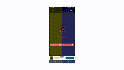

# Scanner QRCode

## Sobre o app

baixe o app 👉 <a href="https://play.google.com/store/apps/details?id=com.scannerqrcode" target="_blank"> </a>
  
Esse app é um projeto feito em flutter que lê códigos de barra qr code e outros tipos de código, ele faz isso pela câmera e também pela galeria o app também constrói qr code personalizado podendo mudar as cores e formas do qr code podendo até mesmo por um logo no centro, o app tem tema claro e escuro, e possui suporte a 3 idiomas, português, inglês e chinês.



## Versões (flavors)

O mesmo código gera os dois apps da Play Store:

| Flavor | Pacote | Diferença |
|---|---|---|
| `free` | `com.scannerqrcode` | anúncios AdMob + botão para o Premium |
| `premium` | `com.scannerqrcode_premium` | sem anúncios |

```bash
flutter run --flavor free
flutter build appbundle --release --flavor free      # build/app/outputs/bundle/freeRelease/
flutter build appbundle --release --flavor premium   # build/app/outputs/bundle/premiumRelease/
```

- No Dart, use `isPremium` (`lib/core/flavor.dart`) para diferenciar.
- Recursos Android só do premium (ícone, splash, permissões removidas) ficam em `android/app/src/premium/`.
- Assets só do premium ficam em `assets/premium/`.
- Assinatura: `android/key.properties` (free) e `android/key-premium.properties` (premium), ambos fora do git.
- `lib/src/shared/admob/controller/admob_controller.dart` também fica fora do git e precisa existir para compilar.

## Problemas atuais do projeto

Hoje o app cria de maneira fácil qr code para wi-fi, contatos e várias outras coisas porém quando você lê um qr code de um contato por mais que ele leia o qr code ele não abre o app de contatos já adicionando o novo contato no telefone isso acontece pq o flutter precisa se comunicar via intent para fazer todo esse processo que facilita a vida do usuário, mas usar esse tipo de intent no flutter ainda é um mistério para mim fiz muitas pesquisas e testes e o que dificulta esse processo é ser algo totalmente nativo, até achei packages que fazem isso porém na documentação não mostra como usar para esse proposito especifico.

## Próximas melhorias

Planejadas para a próxima versão:

- [ ] **Histórico de leituras e de QR codes criados**
  - lista local com data e tipo, busca e favoritos
  - abrir de novo o resultado de uma leitura antiga
  - QRs criados salvos com o estilo (cor, formato, logo), com opção de compartilhar ou gerar de novo
  - sugestão: `sqflite`, ou `shared_preferences` para começar simples
- [ ] **Ações no resultado da leitura** (resolve o problema descrito acima)
  - Wi-Fi: botão "Conectar", com a intent `Settings.ACTION_WIFI_ADD_NETWORKS` (Android 11+, que já é o minSdk)
  - Contato: botão "Adicionar aos contatos", com a intent `ContactsContract.Intents.Insert.ACTION` via `MethodChannel` no `MainActivity.kt`, preenchendo nome, telefone e e-mail do vCard
  - Telefone, SMS, e-mail e evento: abrir o app correspondente (`url_launcher` com `tel:`, `sms:`, `mailto:`)

## Testes Unitários e Testes de Widgets

Os testes finalmente foram feitos \o/ o package não era o problema mas quando eu entendi já tinha removido kkkkk

## Contribua com o projeto

Sinta se a vontade para contribuir com o projeto com código, issues, etc. ...

Se você quiser me apoiar nesse projeto de forma financeira o projeto possui uma versão Premium que sua única diferença é não ter anúncios, atualmente essa versão está custando R$ 3,99.

App Premium 👉 <a href="https://play.google.com/store/apps/details?id=com.scannerqrcode_premium" target="_blank"> 
</a>

##  Flutter links

- [Lab: Write your first Flutter app](https://flutter.dev/docs/get-started/codelab)
- [Cookbook: Useful Flutter samples](https://flutter.dev/docs/cookbook)

For help getting started with Flutter, view our
[online documentation](https://flutter.dev/docs), which offers tutorials,
samples, guidance on mobile development, and a full API reference.
